# 🛡️ Siber Güvenlik Olay Yönetimi (Cybersecurity Incident Management System)

Bu proje, **Nesneye Yönelik Programlama (OOP)** dersi proje ödevi kapsamında geliştirilmiş konsol tabanlı bir **Siber Güvenlik Olay Yönetimi (SOC)** uygulamasıdır. Sistem; kurum ağında meydana gelen siber güvenlik olaylarının sınıflandırılmasını, dinamik risk skorlarına göre önceliklendirilmesini, uygun uzmanlara atanmasını ve müdahale süreçlerinin kalıcı olarak takip edilmesini sağlar.

---

## 📌 Proje Özellikleri

* **Güvenlik Olaylarının Sınıflandırılması:** DDoS, Zararlı Yazılım (Malware) ve Oltalama (Phishing) saldırılarının kendine özgü parametrelerle modellenmesi.
* **Dinamik Önceliklendirme Algoritması:** Olayların baz risk skoru ve bekleme süresi (Aging/Yaşlandırma) hesaba katılarak `PriorityQueue` (Max-Heap) ile sıralanması.
* **Otomatik Analist Atama (Greedy Yaklaşımı):** En yüksek öncelikli açık olayın, saldırı türünde uzmanlaşmış ve iş yükü en az olan siber güvenlik analistine otomatik atanması.
* **Otomatik Kritik Alarm Sistemi:** Kritik seviyedeki (`KRITIK`) saldırılar tespit edildiğinde `Observer` tasarım kalıbı ile anında SOC alarmı üretilmesi.
* **Kalıcı Veri Saklama (Persistence):** Tüm olayların ve durum güncellemelerinin `incidents_db.csv` dosyasında kalıcı olarak saklanması ve uygulama açılışında geri yüklenmesi.

---

## 🧱 Nesneye Yönelik Programlama (OOP) İlkeleri

1. **Sınıf ve Nesne (Class & Object):** Güvenlik olayları, müdahale uzmanları, aksiyon kayıtları ve servis katmanları modüler sınıflar hâlinde tasarlanmıştır.
2. **Soyutlama (Abstraction):** `SecurityIncident` soyut sınıfı (`abstract class`) ile tüm siber olaylar için ortak bir şablon oluşturulmuş; `calculateBaseRiskScore()`, `getIncidentType()` ve `getResponsePlaybook()` gibi soyut metotlar tanımlanmıştır. Ayrıca `IIncidentRepository` ve `IncidentObserver` arayüzleri (`interface`) kullanılmıştır.
3. **Kalıtım (Inheritance):** `DDoSIncident`, `MalwareIncident` ve `PhishingIncident` alt sınıfları `SecurityIncident` üst sınıfından türetilmiştir (`extends`).
4. **Çok Biçimlilik (Polymorphism):** Her saldırı türü, `calculateBaseRiskScore()` ve `getResponsePlaybook()` metotlarını kendi saldırı parametrelerine göre ezerek (`@Override`) farklı risk hesaplamaları ve müdahale adımları üretir.
5. **Kapsülleme (Encapsulation):** Sınıfların tüm veri alanları `private` olarak tanımlanmış; IP formatı kontrolü, negatif değer engellemesi ve boş ID doğrulaması gibi kurallar getter/setter metotları içerisinde kapsüllenmiştir.

---

## ⚙️ Uygulanan SOLID Prensipleri (4 Prensip)

* **Single Responsibility Principle (SRP - Tek Sorumluluk):** Her sınıfın tek bir sorumluluğu vardır. `SecurityIncident` yalnızca olay verisini ve risk hesabını tutar, `FileIncidentRepository` sadece dosya okuma/yazma işlemlerini yürütür, `IncidentPrioritizer` ise yalnızca sıralama ve eşleştirme algoritmasını çalıştırır.
* **Open/Closed Principle (OCP - Açık/Kapalı):** Sistem yeni saldırı türlerine açık, mevcut kodun değiştirilmesine kapalıdır. Sisteme örneğin `SqlInjectionIncident` eklemek için `IncidentManager` veya `IncidentPrioritizer` sınıflarını değiştirmeye gerek yoktur; `SecurityIncident` sınıfından yeni bir alt sınıf türetmek yeterlidir.
* **Liskov Substitution Principle (LSP - Liskov'un Yerine Geçme):** `DDoSIncident`, `MalwareIncident` ve `PhishingIncident` alt sınıfları, üst sınıf olan `SecurityIncident` referansının beklendiği tüm koleksiyonlarda ve metotlarda sistem davranışını bozmadan birbirinin yerine kullanılabilir.
* **Dependency Inversion Principle (DIP - Bağımlılıkların Tersine Çevrilmesi):** Yüksek seviyeli `IncidentManager` sınıfı, düşük seviyeli `FileIncidentRepository` sınıfına doğrudan bağımlı değildir; her ikisi de `IIncidentRepository` soyutlamasına bağımlıdır.

---

## 🧩 Kullanılan Tasarım Kalıpları (Design Patterns)

1. **Factory Method Pattern (`IncidentFactory`):** Kullanıcıdan veya dosyadan gelen metin tabanlı olay türüne (`DDOS`, `MALWARE`, `PHISHING`) göre ilgili alt sınıf nesnesinin oluşturulma karmaşıklığını tek bir merkezde toplar.
2. **Observer Pattern (`IncidentObserver` & `SecurityAlertNotifier`):** Sisteme yeni bir güvenlik olayı kaydedildiğinde, olayın aciliyet seviyesi `KRITIK` ise dinleyici (`SecurityAlertNotifier`) otomatik olarak tetiklenir ve SOC ekranına acil durum bildirimi basar.

---

## 🧮 Önceliklendirme ve Eşleştirme Algoritması

Sistemde düşük öncelikli olayların kuyrukta sonsuza kadar beklemesini (Starvation/Açlık) önlemek amacıyla **Yaşlandırma (Aging) Destekli Max-Heap Öncelik Kuyruğu** algoritması kullanılmıştır:

$$\text{Dinamik Öncelik Skoru} = \text{Baz Risk Skoru} + (\text{Bekleme Süresi (dk)} \times 0.35)$$

1. **Baz Risk Hesabı:** Her alt sınıf kendi metrikleriyle $0 - 100$ arası bir puan üretir (Örn: DDoS için RPS ve Gbps, Malware için zararlı tipi ve etkilenen cihaz sayısı).
2. **Max-Heap Sıralaması:** Çözülmemiş tüm olaylar dinamik öncelik skoruna göre `PriorityQueue` yapısına eklenir ve en acil müdahale edilmesi gereken olay $O(\log N)$ karmaşıklıkla en üste çıkarılır.
3. **Greedy (Açgözlü) Analist Ataması:** Kuyruğun başındaki olay için önce olay türüyle uzmanlık alanı eşleşen, ardından üzerindeki aktif vaka sayısı (`activeIncidentCount`) en düşük olan analist seçilir.

---

## 📊 UML Sınıf Diyagramı

```mermaid
classDiagram
    class SecurityIncident {
        <<abstract>>
        -String id
        -String sourceIp
        -String description
        -IncidentStatus status
        -int waitingMinutes
        -String assignedResponderName
        +calculateBaseRiskScore()* double
        +getIncidentType()* String
        +getResponsePlaybook()* String
        +toCsvRow()* String
        +determineSeverity() SeverityLevel
    }

    class DDoSIncident {
        -int requestsPerSecond
        -double bandwidthGbps
        +calculateBaseRiskScore() double
        +getIncidentType() String
        +getResponsePlaybook() String
    }

    class MalwareIncident {
        -String malwareType
        -int infectedHostCount
        +calculateBaseRiskScore() double
        +getIncidentType() String
        +getResponsePlaybook() String
    }

    class PhishingIncident {
        -int targetedUsersCount
        -boolean credentialsCompromised
        +calculateBaseRiskScore() double
        +getIncidentType() String
        +getResponsePlaybook() String
    }

    class IncidentFactory {
        +createIncident()$ SecurityIncident
    }

    class IncidentObserver {
        <<interface>>
        +onCriticalIncidentDetected(SecurityIncident)
    }

    class SecurityAlertNotifier {
        -List~String~ alertLogs
        +onCriticalIncidentDetected(SecurityIncident)
    }

    class IIncidentRepository {
        <<interface>>
        +saveAll(List~SecurityIncident~)
        +loadAll() List~SecurityIncident~
    }

    class FileIncidentRepository {
        -String filePath
        +saveAll(List~SecurityIncident~)
        +loadAll() List~SecurityIncident~
    }

    class IncidentPrioritizer {
        -double AGING_FACTOR
        +calculateDynamicPriorityScore(SecurityIncident) double
        +prioritizeIncidents(List~SecurityIncident~) List~SecurityIncident~
        +findBestResponder(SecurityIncident, List~IncidentResponder~) IncidentResponder
    }

    class IncidentResponder {
        -String responderId
        -String name
        -String specialization
        -int activeIncidentCount
        +incrementWorkload()
        +decrementWorkload()
    }

    class ResponseAction {
        -String incidentId
        -String responderName
        -String actionNote
        -IncidentStatus newStatus
        -LocalDateTime actionTime
    }

    class IncidentManager {
        -List~SecurityIncident~ incidents
        -List~IncidentResponder~ responders
        -List~IncidentObserver~ observers
        -IIncidentRepository repository
        -IncidentPrioritizer prioritizer
        +registerIncident(SecurityIncident)
        +assignTopPriorityIncident() IncidentResponder
        +updateIncidentStatus(String, IncidentStatus, String) boolean
    }

    SecurityIncident <|-- DDoSIncident
    SecurityIncident <|-- MalwareIncident
    SecurityIncident <|-- PhishingIncident
    SecurityIncident *-- ResponseAction
    IncidentFactory ..> SecurityIncident : creates
    IncidentObserver <|.. SecurityAlertNotifier
    IIncidentRepository <|.. FileIncidentRepository
    IncidentManager --> IIncidentRepository
    IncidentManager --> IncidentPrioritizer
    IncidentManager --> IncidentObserver
    IncidentManager o-- SecurityIncident
    IncidentManager o-- IncidentResponder
```



---

## 🗂️ Sınıf Listesi (12 Sınıf & 2 Arayüz)

1. `SecurityIncident`: Tüm güvenlik olaylarının soyut temel sınıfı.
2. `DDoSIncident`: Dağıtık hizmet engelleme saldırılarını modelleyen alt sınıf.
3. `MalwareIncident`: Zararlı yazılım saldırılarını modelleyen alt sınıf.
4. `PhishingIncident`: Oltalama saldırılarını modelleyen alt sınıf.
5. `IncidentResponder`: Siber güvenlik analistlerini ve iş yüklerini temsil eden sınıf.
6. `ResponseAction`: Olaylara yapılan müdahale adımlarını ve durum geçmişini tutan sınıf.
7. `IncidentFactory`: Nesne üretimini yöneten Factory sınıfı.
8. `SecurityAlertNotifier`: Kritik olaylarda bildirim üreten Observer sınıfı.
9. `IncidentPrioritizer`: Max-Heap önceliklendirme ve analist eşleştirme algoritması sınıfı.
10. `FileIncidentRepository`: Verileri `incidents_db.csv` dosyasına kaydeden ve okuyan sınıf.
11. `IncidentManager`: İş mantığını ve servisleri koordine eden ana yönetici sınıf.
12. `Main`: Konsol menüsünü ve kullanıcı etkileşimini sağlayan başlangıç sınıfı.
* **Arayüzler ve Enumlar:** `IIncidentRepository`, `IncidentObserver`, `SeverityLevel`, `IncidentStatus`.

---

## 🧪 Birim Testleri (JUnit 5 - 8 Test Senaryosu)

`IncidentManagementTest` sınıfı altında sistemin tüm kritik fonksiyonlarını doğrulayan **8 birim testi** bulunmaktadır:

1. `testDDoSRiskScoreCalculation`: DDoS RPS ve Gbps değerlerine göre baz risk skorunun ve `KRITIK` seviyesinin doğrulanması.
2. `testMalwareRiskScoreCalculation`: Fidye yazılımı (Ransomware) ve cihaz sayısına göre risk hesaplamasının doğrulanması.
3. `testIncidentFactoryCreatesCorrectSubclasses`: `IncidentFactory` sınıfının doğru alt sınıf örneği (`PhishingIncident`) ürettiğinin testi.
4. `testEncapsulationInvalidIpThrowsException`: Geçersiz IP adresi girildiğinde kapsülleme doğrulamasının `IllegalArgumentException` fırlattığının testi.
5. `testPriorityQueueOrderingWithAging`: Öncelik kuyruğu algoritmasının yüksek riskli ve bekleyen olayları ilk sıraya aldığının testi.
6. `testObserverTriggeredOnCriticalIncident`: Kritik bir olay eklendiğinde `SecurityAlertNotifier` (Observer) nesnesinin tetiklendiğinin testi.
7. `testGreedyResponderAssignmentBySpecialization`: Olayın, uzmanlık alanı eşleşen doğru analiste otomatik atandığının testi.
8. `testFilePersistenceSaveAndLoad`: Olayların CSV dosyasına kalıcı olarak yazılıp kayıpsız geri okunduğunun testi.

---

## 🚀 Kurulum ve Çalıştırma

Projeyi derlemek, birim testlerini çalıştırmak ve konsol uygulamasını başlatmak için terminalde aşağıdaki komutları kullanabilirsiniz:

```bash
# 1. Birim testlerini çalıştırma (8/8 Test)
mvn test

# 2. Projeyi derleme
mvn compile

# 3. Konsol uygulamasını başlatma
mvn exec:java -Dexec.mainClass="siberolay.Main"
```